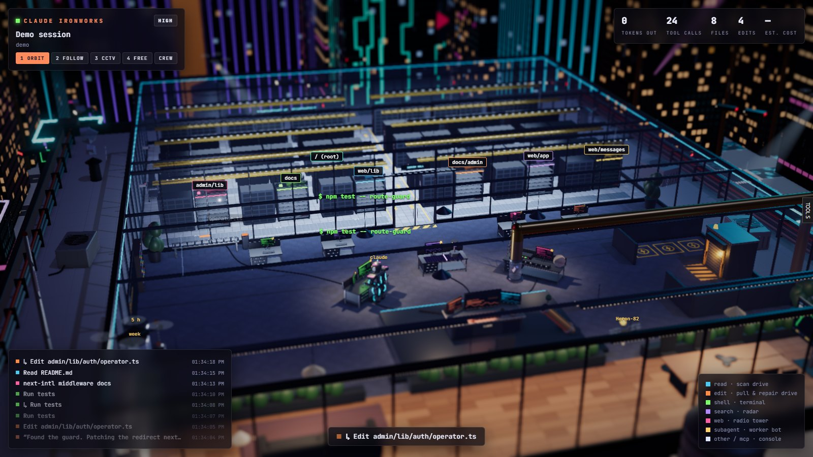
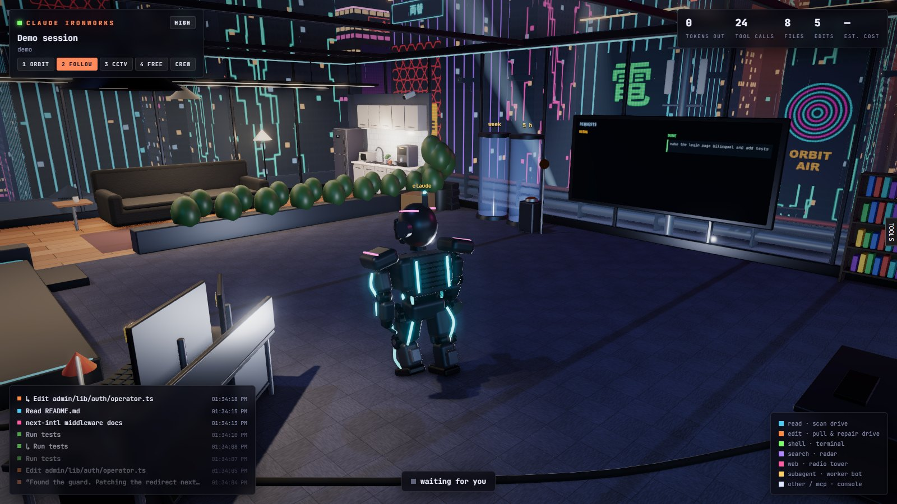
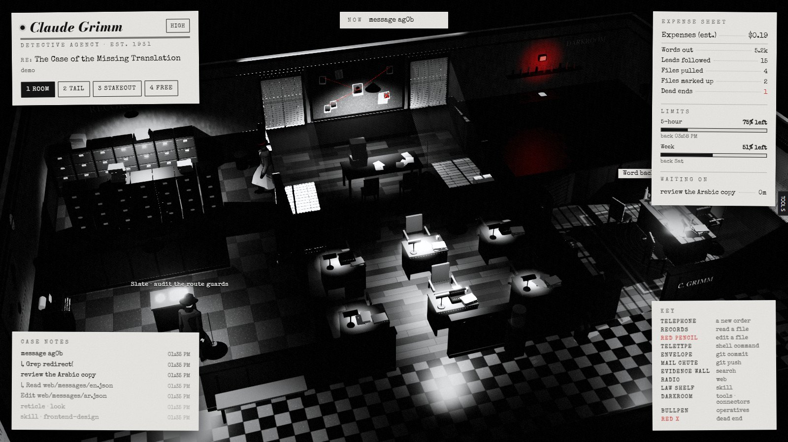
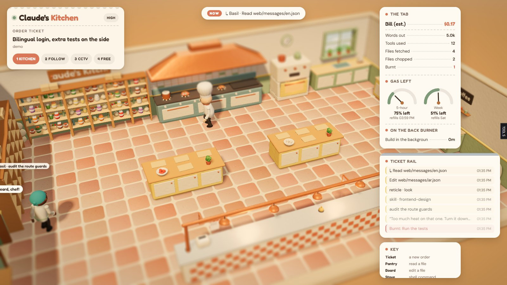

# Code Visualizers

**Watch Claude Code work.** Every file it reads, every edit, every test run and every subagent it spawns becomes something you can see: a robot pulling drives in a neon server hall, a detective working a case in 1931, a cook in a toy kitchen.



A small Node server tails your Claude Code session transcripts as they are written and streams each event to a three.js scene in your browser. It has no dependencies and makes no model calls. It runs next to your terminal and shows what the agent is doing, so you don't have to scroll the log.

## Three worlds, one session

The same live session can be shown three ways. Pick the one you like to leave open on a second monitor.

### Claude Ironworks: cyberpunk server hall

Your repo becomes the building: each folder is a rack and each file a drive. Reads scan a drive, edits pull it out for repair, shell commands go to the terminal, web searches go up the radio tower, and subagents arrive as crew bots with their own jobs. The follow camera stays on Claude between tasks, including the walk to the couch when it's waiting for you.



### Claude Grimm: a 1931 detective agency

The same events in film noir. Your prompt becomes the case title, reads are files pulled from the records room, edits are marked up in red pencil, searches go on the evidence wall, and failed commands are dead ends. Subagents are operatives sent out to the bullpen. The expense sheet keeps a running estimate of what the session costs.



### Claude's Kitchen: a clay-toy kitchen

The cosy version. Your prompt becomes the order ticket. Cooks fetch files from the pantry, chop them at the board, and send shell commands to the stove. A failed run is marked "Burnt". Your plan limits show as gas gauges.



## What's on screen

- **A live feed** of every tool call, colour-coded by kind (read, edit, shell, search, web, subagent, MCP).
- **Session stats:** output tokens, tool calls, files touched, edits and an estimated cost from list prices.
- **Plan limits:** your 5-hour and weekly usage, with the time each one resets.
- **"Waiting for you":** a cue when Claude has stopped and needs your input or approval (see [Permission prompts](#permission-prompts)).
- **Cameras:** `1` orbit, `2` follow, `3` CCTV, `4` free.
- **The Casebook** (`/casebook`): your recent sessions across all projects, with time, cost, tools, edits and failures per prompt.
- **Session picker and replay:** follow any session, not only the newest, or replay one from the start.

## Run it

You need [Node.js](https://nodejs.org) 18 or later and Claude Code. There is nothing to install.

```sh
git clone https://github.com/Blazar70/CodeVisualizers.git
cd CodeVisualizers
node server.js
```

It opens `http://localhost:4747` and follows your most recent Claude Code session. Start a session in another terminal and watch it move.

| Page | URL |
| --- | --- |
| Ironworks | `http://localhost:4747/` |
| Grimm | `http://localhost:4747/grimm` |
| Kitchen | `http://localhost:4747/kitchen` |
| Casebook | `http://localhost:4747/casebook` |

**No session running?** Add `?demo` to any scene URL (for example `http://localhost:4747/kitchen?demo`) to see it driven by a made-up session.

### Options

```sh
node server.js my-project      # only follow sessions whose project name contains "my-project"
node server.js --grimm         # open on Grimm (or --kitchen)
node server.js --no-open       # don't open a browser
node server.js --no-live-usage # don't fetch plan usage (see Privacy)
PORT=5000 node server.js       # use another port
```

On Windows, `start.cmd` runs the server from its own folder, so you can point a desktop shortcut at it.

### Permission prompts

Transcripts don't record when Claude Code stops to ask for permission. To show that in the scene, add a Notification hook to `~/.claude/settings.json`:

```json
{
  "hooks": {
    "Notification": [
      { "hooks": [{ "type": "command", "command": "curl -s -X POST -H \"Content-Type: application/json\" --data-binary @- http://localhost:4747/api/hook" }] }
    ]
  }
}
```

## Privacy

- The server reads `~/.claude/projects/**/*.jsonl` on your machine and listens only on `127.0.0.1`. The API and Casebook routes refuse requests from other hosts.
- It makes one outbound call: once a minute it asks `api.anthropic.com` for your plan usage, with the login Claude Code already stores. Turn this off with `--no-live-usage`; the limits then come from Claude Code's own cached values.
- Costs are estimates from token counts at API list prices, not your bill.

## How it works

```
~/.claude/projects/*.jsonl  ──tail──▶  server.js  ──SSE /events──▶  public/*.html (three.js r160)
```

`server.js` parses each new transcript line into small events (`prompt`, `tool`, `result`, `say`, `think`, `cost` and so on) and pushes them over server-sent events. Each page maps those events onto its own world. Every page is a single self-contained HTML file, so you can open one and read it from top to bottom.

## Credits

Character models and animations in `public/models` are by [Quaternius](https://quaternius.com) (CC0). 3D rendering by [three.js](https://threejs.org).

This is an unofficial fan project and is not affiliated with Anthropic.
